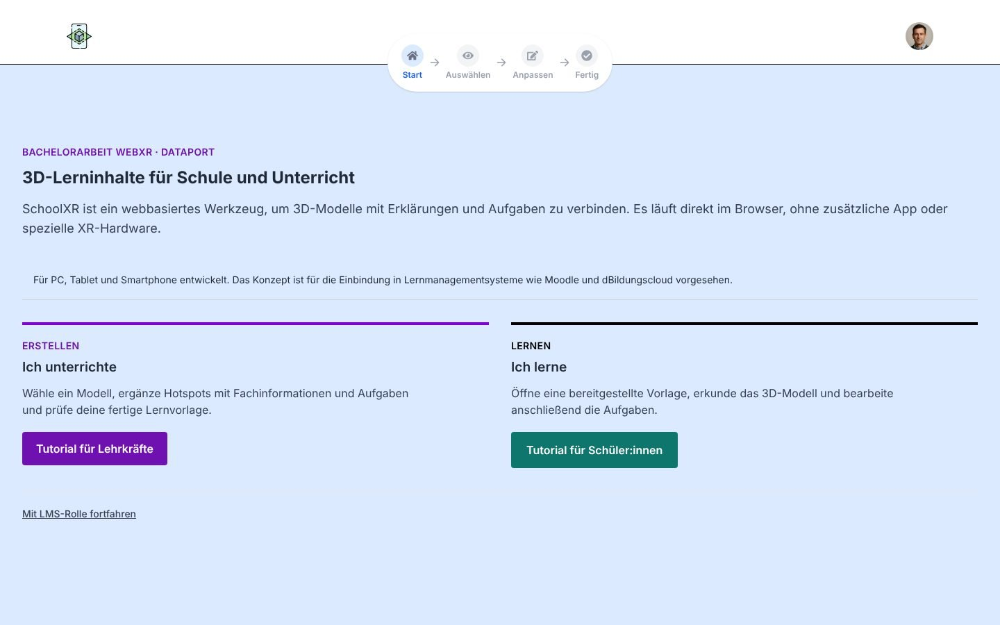
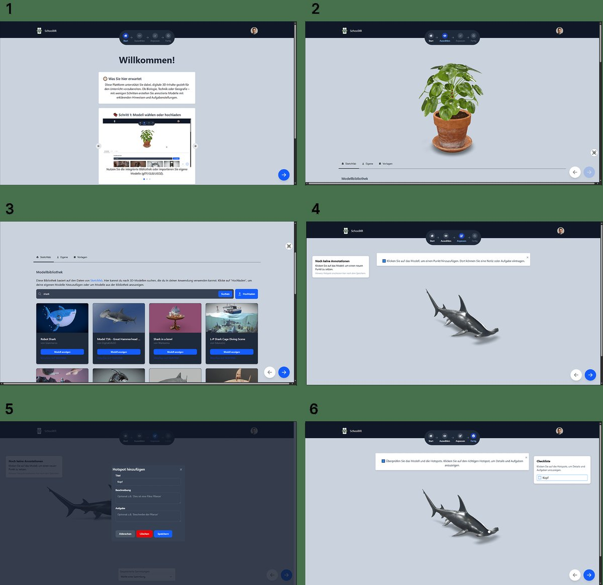
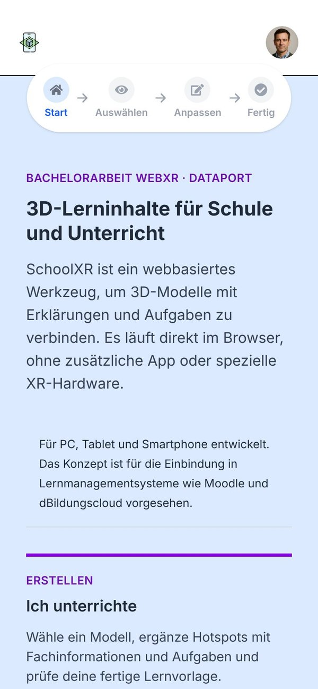
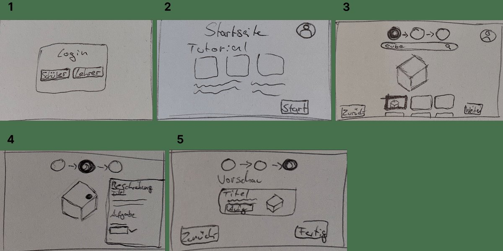
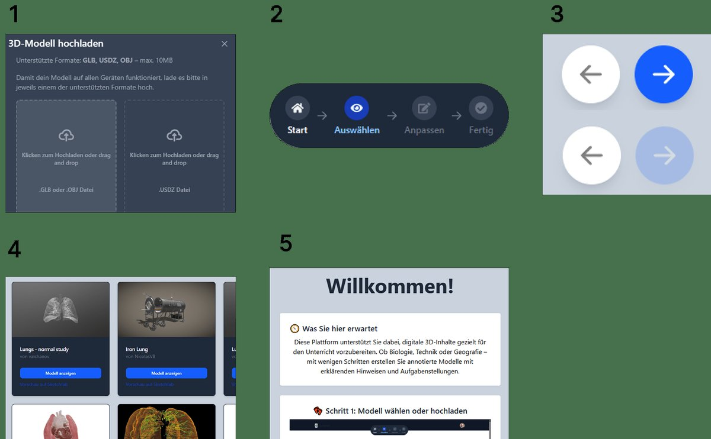

# SchoolXR – 3D-Lerninhalte für den Unterricht

**Bachelorarbeit (B.Eng. Medieningenieurwesen, FH Kiel) in Kooperation mit Dataport.**
SchoolXR ist ein webbasiertes Werkzeug, mit dem Lehrkräfte 3D-Modelle mit Erklärungen und Aufgaben verbinden – und Schüler:innen diese direkt im Browser erkunden. Ohne App-Installation und ohne spezielle XR-Hardware, auf PC, Tablet und Smartphone.



## Das Problem

3D und AR können Unterricht anschaulicher machen, scheitern in Schulen aber oft an Hardware, Installationen und Datenschutz. SchoolXR setzt deshalb komplett auf Web-Technologien und ist für die Einbindung in Lernmanagementsysteme wie **Moodle** und die **dBildungscloud** über **LTI 1.3** konzipiert.

## Funktionen

| Für Lehrkräfte | Für Schüler:innen |
| --- | --- |
| Modell aus der Sketchfab-Bibliothek wählen oder eigenes hochladen (glTF/GLB/USDZ) | Lernvorlage öffnen und das Modell frei drehen, zoomen und erkunden |
| Hotspots direkt am Modell setzen, mit Fachinformationen und Aufgaben | Hotspots anklicken, Erklärungen lesen und Aufgaben bearbeiten |
| Hotspots als Sammlung speichern und wiederverwenden | Fortschritt über eine Checkliste verfolgen |
| Geführter Ablauf: Start → Auswählen → Anpassen → Fertig | Funktioniert auf PC, Tablet und Smartphone |

<table>
  <tr>
    <td width="62%"></td>
    <td width="38%"></td>
  </tr>
  <tr>
    <td align="center"><sub>Geführter Ablauf: Modell wählen, Hotspots setzen, Vorschau prüfen</sub></td>
    <td align="center"><sub>Mobile Ansicht</sub></td>
  </tr>
</table>

## Vorgehen

Die Anwendung ist nutzerzentriert entstanden (Human-Centered Design):

1. **Analyse:** Vergleich bestehender XR-Lösungen, Interviews, drei Personas und User Journeys (siehe `Abgabe/Anhang/`)
2. **Konzept:** Papierprototypen und ein UI-Komponentensystem
3. **Umsetzung:** React-Frontend mit `<model-viewer>` und einem Express-Backend mit LTI-Anbindung
4. **Evaluation:** Usability-Tests mit Lehrkräften und eine ergänzende Online-Umfrage; die Ergebnisse flossen in den zweiten Prototyp ein

<table>
  <tr>
    <td width="50%"></td>
    <td width="50%"></td>
  </tr>
  <tr>
    <td align="center"><sub>Papierprototypen</sub></td>
    <td align="center"><sub>UI-Komponenten: Upload, Stepper, Navigation, Modellbibliothek</sub></td>
  </tr>
</table>

Die vollständige Arbeit liegt unter [`Abgabe/Thesis_Lasse_K.pdf`](Abgabe/Thesis_Lasse_K.pdf).

## Tech-Stack

| Bereich | Technologie |
| --- | --- |
| Frontend | React 19, Vite, React Router, Tailwind CSS, Flowbite |
| 3D | [`<model-viewer>`](https://modelviewer.dev) (WebGL) |
| Modellquelle | Sketchfab API |
| Backend | Node.js, Express, [ltijs](https://cvmcosta.me/ltijs/) (LTI 1.3) |
| Datenbank | MongoDB mit Mongoose |

```text
SchoolXR_Prototype/
├── client/   React-Frontend (Vite)
├── server/   Express-API, LTI-Provider, MongoDB-Anbindung
└── Abgabe/   Bachelorarbeit, Abbildungen und Anhang (Personas, Umfrage, Usability-Tests)
```

---

## Schnellstart (Entwicklungsmodus)

### Voraussetzungen

- Node.js (empfohlen: v18+)
- MongoDB (lokal oder Cloud, z.B. MongoDB Atlas)

### 1. Repository klonen

```bash
git clone https://github.com/L4223/SchoolXR_Prototype.git
cd SchoolXR_Prototype
```

### 2. Umgebungsvariablen anlegen

Erstelle eine `.env`-Datei im `server`-Verzeichnis mit folgendem Inhalt:

```
MONGODB_URI=deine-mongodb-url
MODE=dev
LTI_KEY=irgendein-geheimer-key
PORT=3001
```

Erstelle eine `.env`-Datei im `client`-Verzeichnis mit folgendem Inhalt:

```
VITE_SKETCHFAB_API_KEY=your_sketchfab_api_key_here
```

Passe ggf. die MongoDB-URL an.

### 3. Backend starten

```bash
cd server
npm install
npm run dev
```
Der Server läuft dann auf [http://localhost:3001](http://localhost:3001).

### 4. Frontend starten (separate Console)

```bash
cd ../client
npm install
npm run dev
```
Das Frontend läuft auf [http://localhost:5173](http://localhost:5173).

---

## Produktion/LTI-Modus

- Setze `MODE=prod` in der `.env`
- Richte LTI entsprechend ein (siehe [ltijs Doku](https://cvmcosta.me/ltijs/guide/))
- Starte Backend mit `npm start` (statt `npm run dev`)
- Das Frontend muss gebaut werden: `npm run build` im `client`-Ordner

---

## Benutzung

### 1. Startseite

- Wähle deine Rolle: **Lehrkraft** oder **Schüler:in**
- Folge dem Onboarding oder starte direkt

### 2. Modell auswählen/hochladen

- Wähle ein Modell aus der Bibliothek oder lade ein eigenes hoch

### 3. Editieren (Lehrkraft)

- Klicke auf das Modell, um Hotspots zu setzen
- Fülle Titel, Beschreibung und ggf. Aufgabe aus
- Speichere Hotspots als Sammlung (z.B. "Lektion Pflanzen")
- Lade bestehende Sammlungen über das Dropdown

### 4. Vorschau/Finale Ansicht

- Überprüfe das Modell und die Hotspots
- Schüler:innen können Aufgaben direkt im Modell bearbeiten
- Checkliste zeigt den Fortschritt

---

## API-Routen (Dev-Modus)

- `GET /api/annotations/collections/model/:modelId` – Sammlungen für Modell
- `GET /api/annotations/by-collection/:collectionName` – Hotspots einer Sammlung
- `POST /api/annotations/batch` – Hotspots-Sammlung speichern

---

## Troubleshooting

- **Modelle werden nicht angezeigt?**  
  Prüfe Dateiformate und Pfade.
- **Hotspots erscheinen nicht?**  
  Stelle sicher, dass sie als Children von `<model-viewer>` gerendert werden.
- **Keine Verbindung zur Datenbank?**  
  Prüfe `MONGODB_URI` und dass MongoDB läuft.

---

## Lizenz

MIT License

---

**Viel Spaß beim Ausprobieren!**
